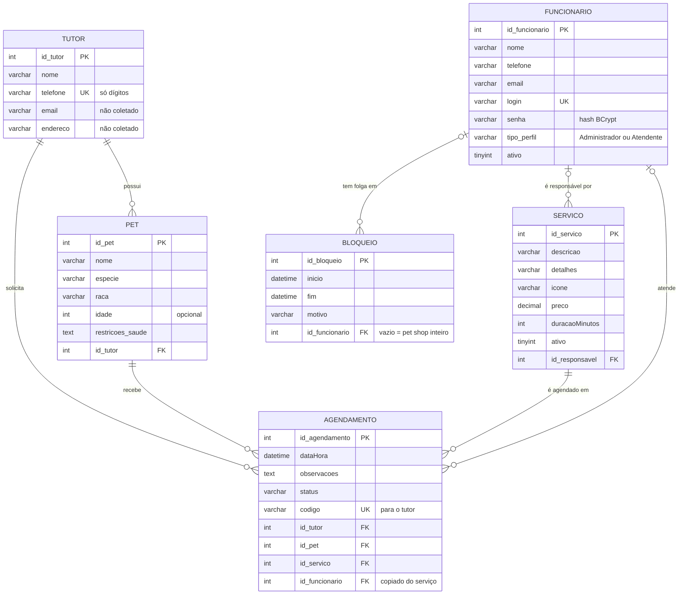
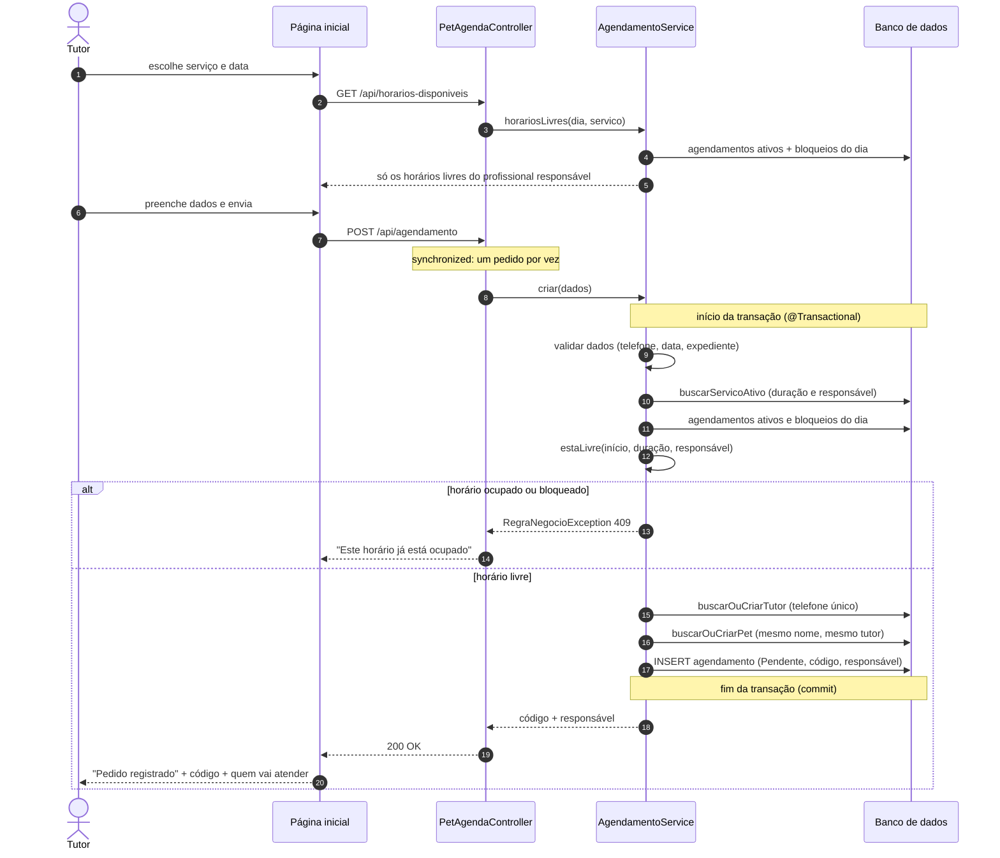
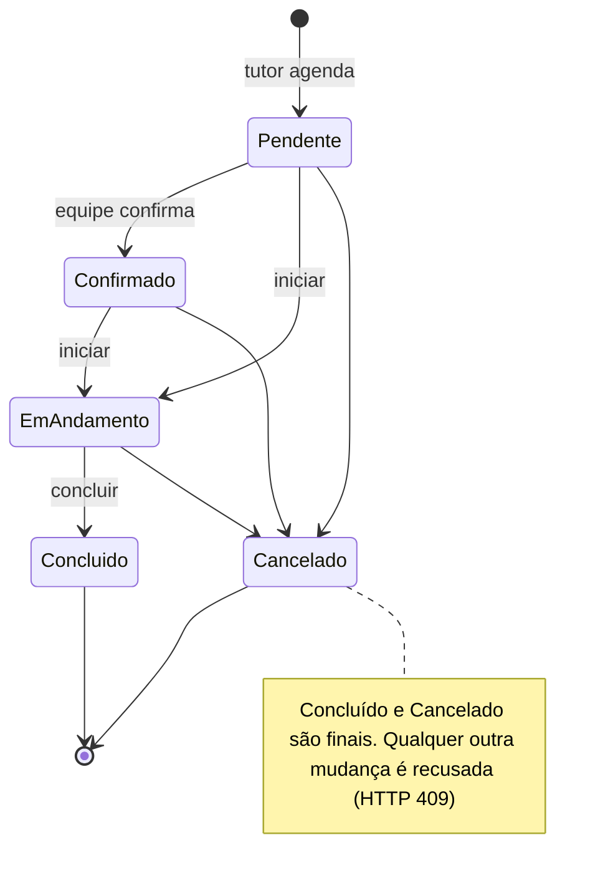

# 13. Diagramas e casos de uso depois da Etapa 3 (18/11/2026)

Este arquivo mostra como o sistema ficou depois do pacote A+B e o que precisa mudar nos desenhos do draw.io para o texto e o sistema dizerem a mesma coisa.

Os diagramas abaixo estão em **Mermaid**. Para ver o desenho, cole o código em https://mermaid.live e redesenhe no draw.io com o mesmo conteúdo, ou exporte a imagem direto de lá.

---

## 1. Modelo entidade-relacionamento (MER)

Gerado a partir de `banco/petagenda.sql`. As colunas `email` e `endereco` do tutor existem no banco, mas o sistema não as coleta (princípio da necessidade da LGPD, art. 6º, III).

**Como explicar na banca:** cada serviço tem um profissional responsável (ex.: Ana faz banho, tosa e escovação; a proprietária, que é veterinária, faz as consultas). Quando o tutor agenda, o responsável é copiado para o agendamento. Assim, se a Ana trocar de função depois, o histórico continua mostrando quem atendeu de fato.

---

## 2. Diagrama de sequência corrigido: "Solicitar agendamento" (UC01)

Diferenças em relação ao desenho atual: o sistema **reaproveita** tutor e pet já cadastrados, **verifica o conflito do mesmo profissional e os bloqueios antes de gravar**, e grava tudo dentro de **uma transação** (ou grava tudo, ou não grava nada).

**Por que a trava fica fora e a transação dentro:** o método do controller é `synchronized` e chama o serviço transacional. Assim, quando a trava é liberada, a transação já foi confirmada no banco, e o próximo pedido já enxerga o agendamento anterior. Se fosse ao contrário, dois pedidos poderiam passar pela verificação antes de qualquer um gravar.

---

## 3. O que mudar em cada diagrama do draw.io

### Diagrama de classes

| Item | Como está no desenho | Como deve ficar |
|---|---|---|
| Classe `Pagamento` | Existe | Tirar, ou marcar como «trabalho futuro» (limitação declarada) |
| Agendamento–Serviço | `1..*` | `1` (um serviço por agendamento; o pacote "Banho + Tosa" cobre o caso comum) |
| Serviço–Funcionário | Não existe | Nova associação "responsável", `0..1` para `0..*` |
| Agendamento–Funcionário | Não existe ou genérica | "atendido por", `0..1` |
| Nova classe `Bloqueio` | Não existe | `inicio`, `fim`, `motivo`; associação `0..1` com Funcionário (vazio = pet shop inteiro) |
| Agendamento | Sem código | Atributo `codigo`; status com Pendente, Confirmado, Em andamento, Concluído e Cancelado |
| Administrador herda de Funcionário | Herança | Pode manter a herança no desenho. No código ela é feita pela coluna `tipo_perfil` (uma tabela só). Vale citar essa decisão no texto |
| Métodos `confirmar()`, `cancelar()`, `finalizar()` | Existem | Mantém: estão implementados pela regra de status (`RegraStatus`) |
| Tutor `email`, `endereco` | Obrigatórios | Tirar, ou marcar como opcionais e não coletados (LGPD) |
| Serviço | `cadastrar/editar/desativar` | Mantém: implementados (tela Serviços). Não existe "apagar": serviço já agendado fica no histórico |

### Diagrama de sequência

Substituir pelo da seção 2.

### Diagrama de casos de uso

Nenhum caso de uso precisa sair. A tabela da seção 4 mostra a situação de cada um.

### Diagrama de estados (sugestão nova)

O texto pode ganhar um diagrama de estados do agendamento, que explica bem a regra de status:

---

## 4. Situação dos casos de uso

| Caso de uso | Situação | Onde está |
|---|---|---|
| UC01 Solicitar agendamento | Implementado | Página inicial |
| UC02 Ver horários livres | Implementado (por profissional e com bloqueios) | Página inicial |
| UC03 Cancelar agendamento (cliente) | **Implementado na Etapa 3** | Meus agendamentos (telefone + código) |
| UC04 Ver histórico | **Implementado na Etapa 3** | Cliente: Meus agendamentos. Equipe: aba "Histórico do tutor" |
| UC05 Gerenciar agenda do dia | Implementado | Painel, aba Agenda |
| UC06 Alterar status | Implementado, agora com regra de transição e "Confirmar" | Painel, aba Agenda |
| UC07 Cadastrar serviços e preços | **Implementado na Etapa 3** | Painel, aba Serviços (só administrador) |
| UC08 Cadastrar profissionais | **Implementado na Etapa 3** | Painel, aba Funcionários (só administrador) |
| UC09 Login | Implementado, agora com perfis e troca de senha | login.html |
| UC10 Bloquear horários | **Implementado na Etapa 3** | Painel, aba Bloqueios (só administrador) |
| UC11 Relatórios e métricas | Implementado (indicadores do dia e do mês) | Painel |
| UC12 Restrições de saúde | Implementado | Formulário e painel |
| Pagamento | Fora do escopo (limitação) | — |

> [CONFERIR] A numeração UC01 a UC12 acima segue a do plano (arquivo 12). Confiram com a numeração exata do diagrama de casos de uso de vocês antes de copiar para o texto.

---

## 5. Novos casos de teste (CT-14 a CT-19)

Todos rodam no roteiro automático `java testes/TestesCT.java`. Rodada de 18/11/2026: **19 passaram, 0 falharam, 2 manuais** (CT-09 e CT-13). Relatório em `testes/resultados/resultado-2026-11-18_01-19.md`.

| Caso | O que faz | Resultado esperado |
|---|---|---|
| CT-14 Status proibido | Tenta voltar um agendamento Concluído e um Cancelado para Pendente | 409 nos dois |
| CT-15 Antichoque por profissional | Já existe Banho (Ana) às 08:00. Agenda Consulta (Dra. Helena) às 08:00 e depois outra Consulta às 08:00 | 1ª Consulta 200, 2ª Consulta 409 |
| CT-16 Bloqueio de agenda | Bloqueia 08:00–12:00 de um dia, tenta agendar às 09:00, remove o bloqueio | Manhã some da lista; agendar dá 409; depois de remover, os 20 horários voltam |
| CT-17 Perfis de acesso | O administrador cria um atendente; o atendente entra e tenta abrir as telas de administrador | Atendente vê a agenda (200), mas Serviços e Funcionários dão 403 |
| CT-18 Meus agendamentos | Agenda, consulta com código errado e certo, cancela duas vezes | 404, 200, 200, 409 |
| CT-19 Serviços e senha | Cria serviço, desativa, troca a senha com a senha atual errada e certa | Serviço aparece e depois some da página; senha errada 400; troca 200 |

Testes de unidade (sem o sistema ligado): `RegraStatusTest` (8), `RegraConflitoTest` (8) e `AgendamentoServiceTest` (8), que usa um banco H2 em memória. O teste `sv02` prova a transação: ele força uma falha na última gravação e confere que tutor e pet não ficaram no banco. Quando a anotação `@Transactional` foi retirada de propósito, esse teste falhou, o que mostra que ele mede a coisa certa.

Verificação de acessibilidade com axe-core (WCAG 2.1 A e AA): 0 problemas na página inicial, Meus agendamentos, login e nas cinco abas do painel. Sem rolagem lateral em tela de 360 px. Prints em `auditoria/prints/etapa3/`.

---

## 6. O que muda no texto do TCC

| Trecho | Antes | Agora |
|---|---|---|
| Conflito "para o mesmo profissional" (Nota 1, Introdução e 3.5; Nota 3) | Não era verdade no sistema | **Verdade.** Cada serviço tem um responsável e o conflito é verificado por profissional. O tutor não escolhe o profissional, ele vê quem vai atender |
| "Controle de concorrência em transações", ACID | Só `synchronized` | `synchronized` + `@Transactional`, com teste que prova o rollback |
| Bootstrap; Spring Data (Nota 1, 3.4) | Não usados | Continua igual: trocar no texto por "CSS próprio" e "Spring JDBC (JdbcTemplate)" |
| Pagamento | No diagrama | Limitação declarada, trabalho futuro |
| "Redução do tempo de registro" (Resumo) | Nunca medido | Continua pendente: medir (CT-UI-11) ou tirar a frase |

**Limitações que continuam:** um único servidor (a trava `synchronized` vale só dentro de um processo); sem HTTPS; sem pagamento nem notificação por WhatsApp; o aceite da LGPD não é gravado no banco; o código do tutor tem 6 caracteres (cerca de 887 milhões de combinações, e ainda precisa do telefone certo), o que é razoável para um MVP mas não substitui um login de cliente.
